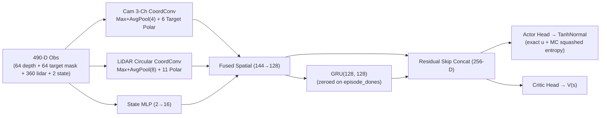

# AckBot RL Architecture & Sensor Contract

This document specifies the canonical sensor observation contract, the Recurrent Spatial `ActorCritic` architecture, the truncated-episode GAE formulation, and the 4-wheel Ackermann kinematics derived from `spec.txt` and `configs/robot_params.yaml`.

---

## 1. Canonical Observation & Action Contract (`490-D` / `2-D`)

Defined in `ackermann_follow/config.py` (`RobotConfig`):

| Slice | Name | Dim | Physical Range | Normalized Range | Ordering / Convention |
| :--- | :--- | :---: | :--- | :--- | :--- |
| `[0 : 64]` | Front camera depth | `64` | `[0.15, 5.00] m` | `[0.0, 1.0]` | Right-to-left (`-42.5°` to `+42.5°` in REP 103 yaw), matching `cam_angles` in `[-1.0, +1.0]` |
| `[64 : 128]` | Front camera RGB target mask | `64` | `{0, 1}` target bbox | `{0.0, 1.0}` | Aligned 1-to-1 with camera depth rays (`1.0` = detected target span, `0.0` = obstacle/empty) |
| `[128 : 488]` | Planar 2D LiDAR | `360` | `[0.10, 3.00] m` | `[0.0, 1.0]` | Counter-clockwise starting from `+X` (`0` to `2π`, `1°` step) |
| `[488 : 490]` | Proprioception (`v`, `steer`) | `2` | `v ∈ [-0.40, 0.80] m/s`, `δ ∈ [-0.553953, +0.553953] rad` | `[-1.0, 1.0]` | Normalized via `RobotConfig.normalize_state()` / `normalize_action()` |

* **Normalization:** `norm_range = (clip(d, d_min, d_max) - d_min) / (d_max - d_min)` (`0.0` = closest hit, `1.0` = max/empty range).
* **Control rate:** `dt = 0.05 s` (`20 Hz`).
* **Action space (`2-D`):** Policy outputs physical `[v, steer]` (`[-0.40, 0.80] m/s`, `[-0.553953, +0.553953] rad`) scaled from `tanh(u) ∈ (-1, 1)`.

---

## 2. Recurrent Spatial `ActorCritic` (`ackermann_follow/ppo/actor_critic.py`)

Key design choices:

1. **Proximity Inversion (`1.0 - range_norm`):** Converts empty max-range rays to `0.0` and nearby hits to `~1.0` so sparse targets produce strong activations against empty background.
2. **Thin-Target-Preserving Pooling & Target-Locked Attention:** A human leg (`r = 0.09 m`) at `2.0 m` subtends only `~5°` (~4 camera rays / ~5 LiDAR rays). Both CNN encoders concatenate `AdaptiveMaxPool1d` + `AdaptiveAvgPool1d`:
   * Camera (`3` input channels `[cam_prox, cam_mask, cam_coord]`, `64 → 32 → 16` → `MaxPool(4) + AvgPool(4)` → `256-D`) + `6` target-locked polar features (`target_soft_bearing`, `target_prox`, `target_vis`, symmetric `21 / 22 / 21` right/center/left obstacle maxima).
   * LiDAR (`360 → 120 → 40` via explicit `F.pad(..., mode="circular")` `_CircularConv1d` → `MaxPool(8) + AvgPool(8)` → `512-D`, exact `5`-bin alignment with the 8 angular sectors) + `11` polar features (`soft_cos`, `soft_sin`, `max_prox`, 8-sector maxima).
3. **MPS- & CUDA-Safe Buffers:** `v_min`, `v_max`, `steer_max`, `v_scale`, `v_bias`, and `steer_scale` are all registered via `register_buffer(...)` from `RobotConfig`, so `.to(device)` moves every scaling constant cleanly.
4. **Exact `TanhNormal` Log-Prob & Squashed Entropy:**
   * Rollouts store both physical `actions` and pre-tanh Gaussian samples `raw_actions` (`u`) in `RolloutBuffer` so PPO updates evaluate `log_prob(u)` directly without `atanh(clamp(...))` drift on saturated samples.
   * Jacobian correction uses the numerically stable identity `2 * (log(2) - u - softplus(-2u))`.
   * Policy entropy is estimated via 1-sample reparameterized Monte Carlo over the squashed distribution (`u_ent = dist.rsample()`), preventing `actor_logstd` inflation when `raw_mean` saturates near `±3.0`.

---

## 3. Truncated-Episode GAE (`ackermann_follow/ppo/buffer.py`)

In `scripts/train_ppo.py`:
* Collisions (`terminated=True`) receive no bootstrap (`V = 0`).
* Time-limit completions (`truncated=True, terminated=False`) add `gamma * V(next_obs)` into `rewards_stored[t]`.

In `RolloutBuffer.compute_returns_and_advantages()`:
* Both bootstrapping to `t + 1` and the GAE eligibility recursion (`gamma * gae_lambda * next_non_terminal * last_gae_lam`) are masked with `next_non_terminal = 1.0 - self.episode_dones[t]` (`terminated | truncated`).
* This guarantees truncated episodes neither double-bootstrap `V(s_0_next_episode)` nor leak advantages backward across episode boundaries.

---

## 4. 4-Wheel Ackermann Kinematics (`spec.txt`)

Given wheelbase $L = 0.30\text{ m}$, track width $W = 0.30\text{ m}$, and minimum center turning radius $R_{\min} = 0.485\text{ m}$:

* **Center virtual steering limit:** $\delta_{\max} = \arctan(L / R_{\min}) = \arctan(0.30 / 0.485) \approx 0.553953\text{ rad}$ ($31.74^\circ$).
* **Inner vs. outer wheel steering angles** at $\delta_{\max}$:
  $$\delta_{\text{inner}} = \arctan\!\left(\frac{L}{R_{\min} - W/2}\right) = \arctan\!\left(\frac{0.30}{0.335}\right) \approx 0.7303\text{ rad } (41.84^\circ)$$
  $$\delta_{\text{outer}} = \arctan\!\left(\frac{L}{R_{\min} + W/2}\right) = \arctan\!\left(\frac{0.30}{0.635}\right) \approx 0.4414\text{ rad } (25.29^\circ)$$

> [!IMPORTANT]
> When authoring the MuJoCo `ackbot.xml` model, front-wheel steering hinge limits and chassis deck corner clearances must accommodate **$\pm 42^\circ$** (`0.74 rad`) for the inner wheel, not just `±31.74°`.
